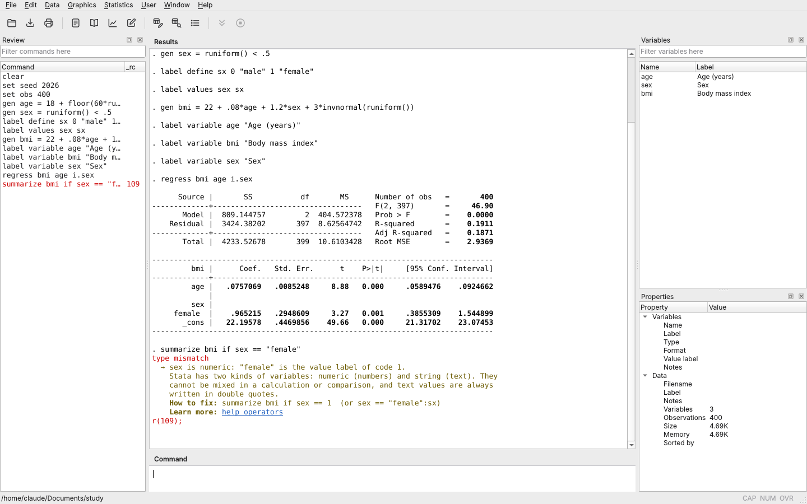

# OpenDTA

**English** | [Português](README.pt-BR.md)

**Stata 14 do-files and `.dta` data, in a free and open program.**

OpenDTA runs do-files written for Stata 14, reads and writes `.dta` datasets and has the desktop interface people already know: the Results, Command, Review, Variables and Properties windows, the Data Editor, the Do-file Editor, the Viewer and the Graph window. It covers data management, descriptive statistics, estimation, complex surveys, survival analysis, multilevel models, time series, multiple imputation, structural equation models, Mata and graphics. When a command fails, it explains the error for beginners, looking at the data in memory, in English or Portuguese.

- [Getting started](docs/getting-started.md)
- [What OpenDTA does](docs/features.md)
- [Roadmap and the Stata 14 commands still missing](ROADMAP.md)
- [Testing and comparing with Stata 14](docs/testing.md)
- [Development](docs/development.md)
- [Development policy (clean room)](docs/clean-room-policy.md)

## Install

- **macOS** 12 or later: [Apple Silicon](https://github.com/yaskepalhares/opendta/releases/latest/download/OpenDTA-macos-apple-silicon.dmg) · [Intel](https://github.com/yaskepalhares/opendta/releases/latest/download/OpenDTA-macos-intel.dmg)
- **Windows** 10 or 11, 64-bit: [installer](https://github.com/yaskepalhares/opendta/releases/latest/download/OpenDTA-windows-x64-setup.exe) · [portable .zip](https://github.com/yaskepalhares/opendta/releases/latest/download/OpenDTA-windows-x64-portable.zip)
- **Linux and other systems**: [from source](docs/getting-started.md#from-source)

The apps are not signed, so the first launch needs one confirmation; see [Getting started](docs/getting-started.md#install). Installed copies check for updates by themselves. All versions are on the [Releases](https://github.com/yaskepalhares/opendta/releases) page.

## Contributing

Read [CONTRIBUTING.md](CONTRIBUTING.md) before opening an issue or a pull request. The most useful report is a difference from Stata 14: open an issue with the [Difference from Stata](https://github.com/yaskepalhares/opendta/issues/new?template=difference-from-stata.md) template and a short do-file. The interface translations live in `src/opendta/i18n.py`, and packaging is described in [docs/development.md](docs/development.md#publishing-a-version).

## Acknowledgements

Built with Python, NumPy, SciPy, Matplotlib, Qt (PySide6) and openpyxl; old `.dta` files are read through ReadStat. The third-party components and their licenses are listed in [packaging/THIRD_PARTY_NOTICES.md](packaging/THIRD_PARTY_NOTICES.md).

OpenDTA is a personal study project, independent and not affiliated with StataCorp. Stata is a registered trademark of StataCorp LLC; OpenDTA uses none of its code, and compatibility is built only from public documentation and observed behavior. Released under the [MIT License](LICENSE).
