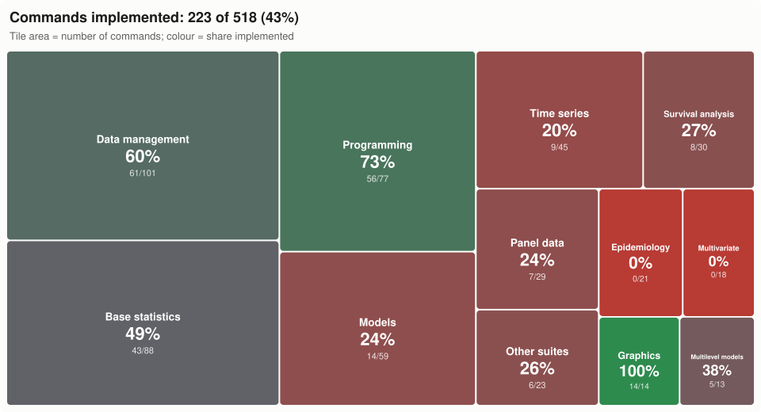

# Roadmap

**English** | [Português](ROADMAP.pt-BR.md)

Goal: cover the commands of Stata 14, including graphics, with an interface as close as possible to the original.

**Version 1.0** closes phases 0 to 9: the core of Stata 14 is in place. The Stata 14 commands still missing are listed in [After 1.0](#after-10) and will be added over time.

The phases are in dependency order. Each one ends with something that can be opened, tested and compared with Stata 14 (see [docs/testing.md](docs/testing.md)). Deadlines are not estimated in advance. Each phase is split into reviewable pull requests.

One tile per area of [After 1.0](#after-10): its size is the number of commands and its colour the share already implemented. Options of existing commands are not counted. Redraw it with `python tools/roadmap_coverage.py` when commands are added.

## Phase 0: foundation ✅

- [x] Do-file lexer: comments, `///`, `#delimit`
- [x] Local and global macros, nested expansion, `=exp`, increment, basic extended functions
- [x] Expressions: precedence, missing-value rules, strings, a first set of functions
- [x] `display` with formats and directives
- [x] Control flow: `forvalues`, `foreach`, `while`, `if`/`else`, `continue`
- [x] `quietly`, `noisily` and `capture` prefixes; `do`, `run` and `include`
- [x] `r(#)` error codes and echo of commands and blocks as in Stata
- [x] Interface: Results, Command, Review, Variables, Properties, menus and toolbar
- [x] Console, batch mode and a tool to compare with Stata logs
- [x] Automated tests and continuous integration

## Phase 1: data in memory and files ✅

**1a ✅**
- [x] Dataset with the `byte`, `int`, `long`, `float`, `double`, `str#` and `strL` types, reproducing `float` precision
- [x] varlists: abbreviations, wildcards (`*`, `?`, `~`), ranges (`a-c`), `_all`
- [x] `if` and `in` qualifiers and the `by`/`bysort` prefix (weights are recognized by the syntax; their use arrives with the statistical commands)
- [x] `_n`, `_N`, `x[_n-1]`, `sum()` and vectorized expressions; sequential `replace` with subscripts
- [x] `clear`, `set obs`, `describe`, `list`, `generate`, `replace`, `drop`, `keep`, `rename`, `order`, `sort`, `gsort`, `label` (variable/define/values/list/dir/drop/data), `format`, `count`, `compress`, `input`
- [x] Variables and Properties windows linked to the data

**1b ✅**
- [x] OpenDTA's own `.dta` reader and writer for formats 117 (13), 118 (14) and 119, with value labels, notes and characteristics; cross-checked against ReadStat in the tests
- [x] Reading old `.dta` files (up to 115, Stata 12 and earlier) through ReadStat (`pip install pyreadstat`)
- [x] `use`, `save`, `saveold`, `recast`, `notes`, `char`, `type`, `erase`, `browse`/`edit`
- [x] `insheet`, `outsheet`, `import delimited`, `export delimited`
- [x] File > Open/Save, drag and drop of `.dta` files, read-only Data Browser

**1c ✅**
- [x] Formats 113–115 (Stata 8–12): OpenDTA's own reader; writing 114/115 with `saveold, version(11|12)`
- [x] `import excel`/`export excel` (.xlsx; .xls with the xlrd package)
- [x] `infile` (free format and with a dictionary), `infix`, `file open/write/read/close`
- [x] Data Editor with cell editing (generates `replace`/`set obs`/`generate`) and Variables Manager

## Phase 2: complete programming language ✅

- [x] `program define`/`end`, `syntax`, `args`, `gettoken`, `marksample`, `markout`
- [x] `return`, `ereturn`, `sreturn`; `tempvar`, `tempname`, `tempfile`; `preserve`/`restore`
- [x] Extended macro functions (`: variable label`, `: type`, `: format`, `: label`, `: char`, `: dir`, `: list`, `: subinstr`, `: permname`, `: r(scalars)`…)
- [x] `matrix` (definition, operators, functions, submatrices, `matrix list`, row and column names)
- [x] Search for `.ado` files on the adopath (runs SSC packages); `sysdir`, `adopath`, `which`, `findfile`, `discard`
- [x] `log using`/`log close` (text and SMCL), `cmdlog`; Viewer with an SMCL renderer, `help`, `view`, `search`
- [x] `assert`, `set trace`, `creturn list`, `timer`
- [x] Help pages for all commands, written from scratch

## Phase 3: descriptive statistics and data management ✅

**3a ✅**
- [x] `summarize` (`detail`, `meanonly`, weights), `tabstat`, `ci`, `ttest`, `prtest`, `correlate`, `pwcorr`, `centile`, `pctile`, `_pctile`, `xtile`
- [x] `tabulate` (one- and two-way, `row`/`col`/`cell`/`expected`, `chi2`, `lrchi2`, `V`, `gamma`, `taub`, `exact` by enumeration), `tab1`, `tab2`, `table`

**3b ✅**
- [x] `egen`: group functions (`count`, `mean`, `sd`, `total`, `min`, `max`, `median`, `mode`, `pctile`, `iqr`, `skew`, `kurt`, `mad`, `mdev`, `std`, `rank`), `group`, `tag`, `seq`, `fill`, `cut`, `concat`, `ends`, `diff` and row functions (`row*`, `any*`)
- [x] `collapse` (all statistics, weights, `cw`), `contract`, `expand`, `fillin`
- [x] `merge` (1:1, m:1, 1:m, m:m, `_n`, `update`/`replace`, `keep()`, `assert()`, `keepusing()`), `append`, `joinby`, `cross`
- [x] `reshape long`/`wide` (with `@`, `string` and repetition of the last specification)

**3c ✅**
- [x] `duplicates` (report/examples/list/tag/drop), `isid`, `levelsof`
- [x] `sample` (percentage or `count`, `if`/`in`, `by()` and the by prefix)
- [x] `recode`, `encode`/`decode`, `destring`/`tostring`, `split`, `mvencode`/`mvdecode`
- `distinct` is not an official command: it is an SSC package and runs through the adopath (phase 2).

**3d ✅**
- [x] 64-bit Mersenne Twister generator (Stata 14's mt64), `set seed` (number or state), `c(seed)`, `set rng`
- [x] `runiform()`, `runiformint()`, `rnormal()`, `rbinomial()`, `rpoisson()`, `rchi2()`, `rt()`, `rbeta()`, `rgamma()`, `rexponential()`, `rlogistic()`, `rweibull()`, `rnbinomial()`, `rhypergeometric()`. The seed conversion and the algorithm of each distribution are not documented: results are statistically equivalent but not identical to Stata's (cases in `compat/do/0307_aleatorios.do`).

**Checked against Stata 14**: the 28 cases in `compat/do/` have references produced in Stata/SE 14.0; 25 match line by line. The known differences are listed in `compat/known_differences.txt`: the progress of the network algorithm of `tabulate, exact` (tables larger than 2×2) and, for random numbers, `rnormal()`, `runiformint()`, `rpoisson()` and `rt()` (`runiform()`, `rbinomial()`, `rexponential()` and `rchi2(2)` already reproduce Stata's exact sequence).

## Phase 4: Mata ✅

**4a–4c ✅**
- [x] Lexer and parser with Mata's precedence; real, string, complex, pointer and struct types; scalars, vectors and matrices
- [x] Operators (arithmetic, colon, transpose, Kronecker, `,` and `\` joins, `..` and `::` ranges, relational, logical, `?:`), `[i,j]` and `[|...|]` subscripts, missing values propagated as in Stata
- [x] Control flow (`if`, `for`, `while`, `do`, `break`, `continue`, `return`), typed user functions, optional arguments and pass by reference, `struct`, pointers
- [x] `mata`/`mata:` ... `end` blocks with Stata's echo, `mata: statement`, `mata clear/describe/drop`; errors in Mata's format (`<istmt>:  3499  x not found`)
- [x] Library: ~150 functions (mathematical, matrix, statistical, missing values, strings, `printf`/`sprintf`)
- [x] Link to the data: `st_data`, `st_sdata`, `st_view` (copy), `st_store`, `st_addvar`, `st_local`, `st_global`, `st_numscalar`, `st_matrix`, `stata()`

**4d ✅**
- [x] Display, messages and errors checked against Stata 14 (cases `compat/do/0401`–`0405`): numbers in `%12.0g`, single-width columns, block header, compile and run-time errors, skipped lines in `mata:`
- [x] `st_view` that writes to the data when elements are assigned; associative arrays (`asarray`); `optimize()` with d0/d1/d2 evaluators and nr/bfgs techniques
- [x] Check `optimize()`, `st_view` and `asarray` (cases `0406` and `0407`; in d0 `optimize()` only the noise of numerical derivatives differs)
- `moptimize()` moved to phase 5, together with `ml`; Mata classes, to phase 8

## Phase 5: estimation ✅

- [x] Factor variables (`i.`, `c.`, `#`, `##`) and time-series operators (`L.`, `F.`, `D.`, `S.`); `tsset`, `xtset`
- [x] `regress`, `predict`, `test`, `testparm`, `lincom`, `nlcom`, `margins`, `estimates store/table/restore`
- [x] `logit`, `logistic`, `probit`, `ologit`, `oprobit`, `mlogit`, `poisson`, `nbreg`, `glm`, `tobit`, `ivregress`, `xtreg`, `areg`
- [x] Robust, cluster and bootstrap standard errors (`vce(bootstrap)` and the `bootstrap` prefix); `ml` engine (maximum likelihood)
- [x] `xtlogit` and `xtpoisson` (fe and re), `qreg`, `lrtest`, `hausman`, `xtsum`, `xtdescribe`
- [x] Mata's `moptimize()` (lf, d0–d2, lf0–lf2 and gf0–gf2 evaluators; oim, opg and robust variance; case `0408` awaits the Stata run)
- Checked against the Stata logs: cases `0501`–`0513`

## Phase 6: complex surveys ✅

- [x] `svyset` (strata, PSUs, weights, FPC), `svydescribe`
- [x] `svy:` prefix with `mean`, `proportion`, `ratio`, `total`, `tabulate`, `regress`, `logit`, `logistic`, `poisson`; `subpop()` and `over()`
- [x] Taylor linearization; Rao–Scott correction in two-way `svy: tabulate`
- [x] Several stages, BRR, jackknife, bootstrap and SDR; `estat effects`; `svy:` also with `ologit`, `oprobit`, `mlogit`, `nbreg`, `glm` and `tobit`
- Checked against the Stata logs: cases `0601` and `0602`; `0603` awaits the next run

## Phase 7: graphics ✅

- [x] Graphics engine with OpenDTA's own schemes (`s2color`, `s1mono`… are accepted and mapped to them) and Graph window
- [x] `twoway` (`scatter`, `line`, `connected`, `lfit`, `qfit`, `lfitci`, `qfitci`, `area`, `bar`, `spike`, `dropline`, `rcap`, `rarea`, `rbar`, `rline`, `function`, `histogram`, `kdensity`, `scatteri`), `tsline`, `graph bar`/`hbar`, `graph box`/`hbox`, `graph pie`, `histogram`, `kdensity`, `graph matrix`
- [x] Title, axis, legend and marker options; `by()`
- [x] `graph combine`, `graph export` (PNG, PDF, SVG, EPS, PS, TIFF, JPEG), `graph save`/`use` (OpenDTA's own format), `graph dir`/`drop`/`rename`/`copy`/`display`/`describe`
- [x] `lowess`, `graph dot`, `marginsplot`, diagnostic plots (`rvfplot`, `rvpplot`, `qnorm`, `pnorm`)
- [x] Simple Graph Editor (titles, legend, scheme, size, grid, log scales), with undo
- Checked against the Stata logs: case `0701` (text messages only; the drawing is OpenDTA's own)

## Phase 8: the rest of Stata 14 and interface tools ✅

- [x] Do-file Editor with tabs, syntax highlighting, find/replace and execution of the selection (`doedit`); Data, Graphics and Statistics menus; printing
- [x] Nonparametric and normality tests (`ranksum`, `signrank`, `kwallis`, `spearman`, `swilk`, `sktest`, `sdtest`) and immediate commands (`cii`, `ttesti`, `prtesti`, `tabi`)
- [x] `oneway`, `anova`, `tabulate, summarize()`, `estat` (`ic`, `vce`, `summarize`, `hettest`, `ovtest`, `classification`, `gof`, `bootstrap`)
- [x] `codebook`, `misstable`, `putexcel`
- [x] Mata classes (`class`, `extends`, virtual methods, `super`, `this`, static members, constructors; case `0409` awaits the Stata run)
- [x] Survival analysis: `stset` (with `id()`, `time0()`, `origin()`, `enter()`, `exit()`, `scale()`), `st`, `streset`, `stdescribe`, `stsum`, `sts list`/`generate`/`test`/`graph` (Kaplan-Meier, Nelson-Aalen, log-rank, Wilcoxon, Tarone-Ware, Peto-Peto), `stcox` (Breslow and Efron ties, strata, robust), `estat phtest`, `streg` (exponential, Weibull, Gompertz, lognormal, loglogistic) and their `predict` options; cases `0901`–`0902` await the Stata run
- [x] Multilevel models: `mixed` (ML and REML, nested levels, random slopes, identity/independent/exchangeable/unstructured covariances; `estat icc`, `group`, `recovariance`; `predict`) and `melogit`, `meprobit`, `mepoisson` (adaptive Gauss-Hermite quadrature); cases `1001`–`1002` await the Stata run
- [x] Time series: `arima` (exact ML with the Kalman filter, OPG variance), `var`, `varsoc`, `vargranger`, `dfuller` (Fuller critical values, MacKinnon p-values), `corrgram`, `newey`; case `1101` awaits the Stata run
- [x] Multiple imputation: `mi set` (mlong, flong), `register`, `describe`, `impute` (`regress`, `pmm`, `logit`, `ologit`, `mlogit`, `poisson`, `chained`), `estimate` (Rubin's rules, Barnard-Rubin df), `passive`, `xeq`, `extract`, `misstable`; case `1201` (imputed values differ from Stata's: known difference)
- [x] `sem` (path models, CFA and latent variables by ML, standardized solution, `estat gof`, `predict`), `power` (`onemean`, `twomeans`, `pairedmeans`, `oneproportion`, `twoproportions`, `onecorrelation`, `twocorrelations`) and `irf` (`create`, `table`, `graph`, `describe`, `rename`, `drop` after `var`); cases `1301`–`1303` await the Stata run
- [x] Completed commands: `anova` (sequential sums of squares, nested terms, error terms, repeated measures), `xtgee` and the `pa` estimator of `xtreg`/`xtlogit`/`xtpoisson`, `xtreg, be` and `mle`, two-way `tabulate, summarize()`, `misstable tree`/`nested`, `ci`/`cii variances`, two-sample `prtest`/`prtesti`, `reshape i/j/xij/error`, the old `merge` syntax, `sort ... in`, `list, sepby()`, `display _request()`, `export excel` to `.xls`, `set rng kiss32`; sequential `replace` with time-series operators (`replace y = 2*L.y`); case `0805` awaits the Stata run
- [x] Menu dialogs (38 Statistics and Graphics commands), with a preview of the command and OK, Submit and Copy
- [x] Help pages for all commands
- [x] macOS package (`tools/build_macos.sh`: `OpenDTA.app` and `.dmg`; "Open With" for `.do` and `.dta`)
- Checked against the Stata logs: cases `0801`–`0804`

## Phase 9: interface language ✅

- [x] Settings window with a sidebar and search: theme (light, dark or system), app icon, font with preview, language, error explanations, superscript exponents, numerics and updates, applied at once
- [x] Language selector in Settings: English (default) or Portuguese, for menus, windows, dialogs, error explanations and OpenDTA's own messages
- [x] With Portuguese on, Stata-style messages can stay in English (for those who compare with Stata logs and manuals) or be translated, at the user's choice (`set language`, `set messages`)

## Distribution and documentation

- [x] MIT License and license notices for third-party components
- [x] macOS download (Apple Silicon and Intel), with the Release built by GitHub Actions for every `v*` tag
- [x] All documentation published on GitHub in English, with a Portuguese copy (`*.pt-BR.md`) and an **English | Português** selector at the top of each page; code comments and commit messages in English
- [x] Update check and installation from inside the app (GitHub Releases, verified download, daily check that can be turned off)
- [x] Windows download (64-bit, Intel/AMD): per-user installer and portable `.zip`, built by the same workflow
- [x] Version 1.0: short README with a screenshot, documentation in `docs/` (getting started, features, testing, development), `CONTRIBUTING.md`, issue templates (difference from Stata, bug, command request) and a pull request template; the release workflow checks that the tag matches the version

## Improvements over Stata (throughout the phases)

- [x] Error explanations: after the message and before r(#), one line says what went wrong in the context of the command and another suggests how to fix it (similar names, similar files in the folder, number of observations…). In English or Portuguese, following the interface language; `set hints off` turns them off
- [x] Explanations for beginners: what went wrong with the data at hand (missing values per variable, string or numeric variables, values of the outcome, contradictions of assert, matrix sizes), why the rule exists, the corrected command (= for ==, egen functions in generate, quotes for text and value labels, bysort, names without spaces or accents...) and a clickable help link; new help pages for operators, functions, missing values and by
- [x] `set numerics precise`: QR in `regress`, `D.`/`S.` in double, a final Newton step in `ml`/`optimize()`, Richardson extrapolation for numerical derivatives and new variables in double (the default `stata` reproduces Stata's rounding)
- [ ] Statistical options beyond Stata: `vce(cr2)` with Satterthwaite degrees of freedom, *wild cluster bootstrap*, `logit, firth`
- [x] Superscript exponents in displayed scientific notation (`1.0000×10¹⁰`, `2.5×10⁻⁵`), keeping the format width; `set superscript off` (or Help → Superscript Exponents) restores Stata's `e+10`. `string()`, macros, `file write`, exports and Mata's `sprintf()`/`strofreal()` always use Stata's form

## After 1.0

Stata 14 commands and options that OpenDTA does not have yet, by area. They will be added over time; the order follows use and the requests opened with the [Command request](https://github.com/yaskepalhares/opendta/issues/new?template=command-request.md) template.

- **Data management**: `clonevar`, `ds`, `lookfor`, `sysuse`/`webuse`, `xpose`, `stack`, `separate`, `ipolate`, `range`, `drawnorm`, `corr2data`, `expandcl`, `inspect`, `labelbook`, `compare`, `cf`, `datasignature`, `checksum`, `snapshot`, `statsby`, `outfile`, `insobs`, `putmata`, `icd9`/`icd10`, `bcal`, `unicode`, `odbc`, `filefilter`, `zipfile`, `mkdir`, `rmdir`, `copy`, `shell`, `dir`; `table` with three or more variables; `import sas`, `spss`, `sasxport` and `haver`; binary `file` read/write; `infile, byvariable()`; `putexcel` to `.xls`; options of `list` and `describe` that are still missing.
- **Epidemiology**: `cs`/`csi`, `cc`/`cci`, `ir`/`iri`, `mcc`/`mcci`, `tabodds`, `mhodds`, `dstdize`/`istdize`, `symmetry`, `kappa`/`kap`, `roctab`, `roccomp`, `rocreg`, `rocfit`, `lroc`, `lsens`.
- **Base statistics**: the `ml` command (the engine exists), `mlexp`, `jackknife`, `permute`, `simulate`, `nestreg`, `stepwise`, `xi`, `mkspline`, `fp`/`mfp`, `contrast`, `pwcompare`, `pwmean`, `margins` after more commands, `suest`, `predictnl`, `testnl`, `linktest`, `boxcox`, `ladder`/`gladder`, `lnskew0`, `bitest`, `ksmirnov`, `median`, `nptrend`, `runtest`, `cusum`, `serrbar`, `tetrachoric`, `ktau`, `pcorr`, `icc`, `loneway`, `esize`, `ameans`, `cumul`, `stem`, `dotplot`, `lv`, `lpoly`, `smooth`, `sunflower`, `symplot`, `quantile`.
- **Models**: `clogit`, `cloglog`, `scobit`, `hetprobit`, `heckman`, `heckprobit`, `heckoprobit`, `biprobit`, `ivprobit`, `ivtobit`, `ivpoisson`, `intreg`, `truncreg`, `zip`, `zinb`, `tpoisson`, `tnbreg`, `gnbreg`, `fracreg`, `binreg`, `glogit`, `asclogit`, `asmprobit`, `asroprobit`, `mprobit`, `rologit`, `slogit`, `exlogistic`, `expoisson`, `cnsreg` and `constraint`, `nl`, `nlsur`, `gmm`, `rreg`, `sureg`, `reg3`, `eivreg`, `vwls`, `frontier`; `ivregress liml` and `gmm`; `teffects`, `stteffects`, `etregress`, `etpoisson`, `eteffects`.
- **Panel data**: `xtprobit`, `xtcloglog`, `xtnbreg`, `xttobit`, `xtintreg`, `xtologit`, `xtoprobit`, `xtivreg`, `xtabond`, `xtdpd`, `xtdpdsys`, `xthtaylor`, `xtfrontier`, `xtgls`, `xtpcse`, `xtregar`, `xtrc`, `xtunitroot`, `xtline`, `xttab`, `xtdata`, `quadchk`.
- **Survival analysis**: `stcrreg`, `stci`, `strate`, `stptime`, `stir`, `stmh`, `stmc`, `stsplit`, `stjoin`, `stfill`, `stgen`, `stbase`, `stvary`, `ltable`, `stcurve`, `sttocc`, `sttoct`, `snapspan`, `ct`; `streg, distribution(ggamma)` and `frailty()`; the `exactm` and `exactp` ties of `stcox`.
- **Time series**: `arch`, `arfima`, `dfactor`, `sspace`, `ucm`, `mgarch`, `vec` and `vecrank`, `svar`, `fcast`, `varbasic`, `varlmar`, `varnorm`, `varstable`, `varwle`, `dfgls`, `pperron`, `prais`, `rolling`, `tsappend`, `tsfill`, `tsreport`, `tsfilter`, `tssmooth`, `pergram`, `cumsp`, `xcorr`, `wntestb`, `wntestq`, `psdensity`; `arima` with `sarima()`, `condition` and `diffuse`; `irf` after `svar` and `vec`, with bootstrap standard errors, and `irf ctable`, `cgraph`, `ograph` and `add`.
- **Multivariate statistics**: `pca`, `factor`, `rotate`, `alpha`, `cluster`, `discrim`, `manova`, `mvreg`, `mvtest`, `canon`, `ca`/`mca`, `mds`, `biplot`, `procrustes`, `hotelling`, `screeplot`, `scoreplot`.
- **Multilevel models**: `meglm`, `mecloglog`, `menbreg`, `meologit`, `meoprobit`, `meqrlogit`, `meqrpoisson`, `mestreg`; crossed random effects in `mixed`.
- **Other suites**: `gsem`; `sem` with the `mlmv` and `adf` methods, `group()` and the other `estat` subcommands; the other `power` methods (variances, `oneway`, `twoway`, `repeated`, `cox`, `logrank`, `exponential`), the `lrchi2` and `fisher` tests and graphs; `bayesmh` and the `bayes` commands; `irt`; `mi impute mvn`, `monotone`, `truncreg`, `intreg` and `nbreg`; `svy:` with more estimators.
- **Programming**: `postfile`/`post`, `unab`, `tsunab`, `fvunab`, `fvexpand`, `fvrevar`, `tsrevar`, `mark`, `_rmcoll`, `matlist`, `tabdisp`, `sortpreserve`, `signestimationsample`, `makecns`, `pause`, `sleep`, `window`, `plugin`, `viewsource`, `unabcmd`, Stata's class system (Mata classes already work).

Out of scope: reading the `.gph` files saved by Stata, whose format has no public specification ([development policy](docs/clean-room-policy.md)); OpenDTA saves graphs in its own `.gph` format.
