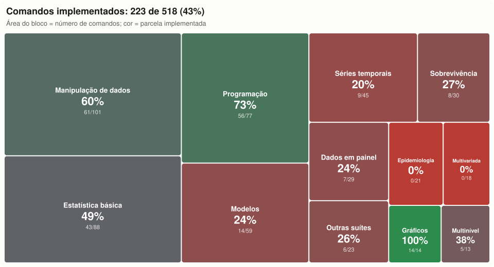

# Roadmap

[English](ROADMAP.md) | **Português**

Meta: cobrir os comandos do Stata 14, incluindo gráficos, com a interface o mais próxima possível da original.

**A versão 1.0** fecha as fases 0 a 9: o núcleo está pronto. Os comandos que ainda faltam estão listados em [Depois da 1.0](#depois-da-10) e serão acrescentados aos poucos.

As fases estão em ordem de dependência. Cada uma termina com algo que dá para abrir, testar e comparar com o Stata (ver [docs/testing.pt-BR.md](docs/testing.pt-BR.md)). Os prazos não são estimados de antemão. Cada fase é dividida em pull requests revisáveis.

Um bloco por área de [Depois da 1.0](#depois-da-10): o tamanho é o número de comandos e a cor, a parcela já implementada. Opções de comandos existentes não entram na conta. Redesenhe com `python tools/roadmap_coverage.py` quando houver comandos novos.

## Fase 0: fundação ✅

- [x] Lexer de do-files: comentários, `///`, `#delimit`
- [x] Macros locais e globais, expansão aninhada, `=exp`, incremento, funções estendidas básicas
- [x] Expressões: precedência, regras de missing, strings, primeira leva de funções
- [x] `display` com formatos e diretivas
- [x] Controle de fluxo: `forvalues`, `foreach`, `while`, `if`/`else`, `continue`
- [x] Prefixos `quietly`, `noisily` e `capture`; `do`, `run` e `include`
- [x] Códigos de erro `r(#)` e eco de comandos e blocos no padrão do Stata
- [x] Interface: Results, Command, Review, Variables, Properties, menus e barra de ferramentas
- [x] Console, modo batch e ferramenta de comparação com logs do Stata
- [x] Testes automáticos e integração contínua

## Fase 1: dados em memória e arquivos ✅

**1a ✅**
- [x] Conjunto de dados com tipos `byte`, `int`, `long`, `float`, `double`, `str#` e `strL`, com a precisão de `float` reproduzida
- [x] varlists: abreviações, curingas (`*`, `?`, `~`), intervalos (`a-c`), `_all`
- [x] Qualificadores `if` e `in` e o prefixo `by`/`bysort` (pesos são reconhecidos na sintaxe; o uso chega com os comandos estatísticos)
- [x] `_n`, `_N`, `x[_n-1]`, `sum()` e expressões vetorizadas; `replace` sequencial com subscritos
- [x] `clear`, `set obs`, `describe`, `list`, `generate`, `replace`, `drop`, `keep`, `rename`, `order`, `sort`, `gsort`, `label` (variable/define/values/list/dir/drop/data), `format`, `count`, `compress`, `input`
- [x] Janelas Variables e Properties ligadas aos dados

**1b ✅**
- [x] Leitura e gravação próprias de `.dta` nos formatos 117 (13), 118 (14) e 119, com rótulos de valor, notas e características; verificação cruzada com a ReadStat nos testes
- [x] Leitura de `.dta` antigos (até 115, Stata 12 e anteriores) pela ReadStat (`pip install pyreadstat`)
- [x] `use`, `save`, `saveold`, `recast`, `notes`, `char`, `type`, `erase`, `browse`/`edit`
- [x] `insheet`, `outsheet`, `import delimited`, `export delimited`
- [x] File > Open/Save, arrastar e soltar `.dta`, Data Browser somente leitura

**1c ✅**
- [x] Formatos 113–115 (Stata 8–12): leitura própria; gravação 114/115 com `saveold, version(11|12)`
- [x] `import excel`/`export excel` (.xlsx; .xls com o pacote xlrd)
- [x] `infile` (formato livre e com dicionário), `infix`, `file open/write/read/close`
- [x] Data Editor com edição de células (gera `replace`/`set obs`/`generate`) e Variables Manager

## Fase 2: linguagem de programação completa ✅

- [x] `program define`/`end`, `syntax`, `args`, `gettoken`, `marksample`, `markout`
- [x] `return`, `ereturn`, `sreturn`; `tempvar`, `tempname`, `tempfile`; `preserve`/`restore`
- [x] Funções estendidas de macro (`: variable label`, `: type`, `: format`, `: label`, `: char`, `: dir`, `: list`, `: subinstr`, `: permname`, `: r(scalars)`…)
- [x] `matrix` (definição, operadores, funções, submatrizes, `matrix list`, nomes de linhas e colunas)
- [x] Busca de `.ado` no adopath (permite rodar pacotes do SSC); `sysdir`, `adopath`, `which`, `findfile`, `discard`
- [x] `log using`/`log close` (texto e SMCL), `cmdlog`; Viewer com renderizador de SMCL, `help`, `view`, `search`
- [x] `assert`, `set trace`, `creturn list`, `timer`
- [x] Páginas de help para todos os comandos, escritas do zero

## Fase 3: estatística descritiva e manipulação ✅

**3a ✅**
- [x] `summarize` (`detail`, `meanonly`, pesos), `tabstat`, `ci`, `ttest`, `prtest`, `correlate`, `pwcorr`, `centile`, `pctile`, `_pctile`, `xtile`
- [x] `tabulate` (uma e duas vias, `row`/`col`/`cell`/`expected`, `chi2`, `lrchi2`, `V`, `gamma`, `taub`, `exact` por enumeração), `tab1`, `tab2`, `table`

**3b ✅**
- [x] `egen`: funções de grupo (`count`, `mean`, `sd`, `total`, `min`, `max`, `median`, `mode`, `pctile`, `iqr`, `skew`, `kurt`, `mad`, `mdev`, `std`, `rank`), `group`, `tag`, `seq`, `fill`, `cut`, `concat`, `ends`, `diff` e funções de linha (`row*`, `any*`)
- [x] `collapse` (todas as estatísticas, pesos, `cw`), `contract`, `expand`, `fillin`
- [x] `merge` (1:1, m:1, 1:m, m:m, `_n`, `update`/`replace`, `keep()`, `assert()`, `keepusing()`), `append`, `joinby`, `cross`
- [x] `reshape long`/`wide` (com `@`, `string` e repetição da última especificação)

**3c ✅**
- [x] `duplicates` (report/examples/list/tag/drop), `isid`, `levelsof`
- [x] `sample` (percentual ou `count`, `if`/`in`, `by()` e o prefixo by)
- [x] `recode`, `encode`/`decode`, `destring`/`tostring`, `split`, `mvencode`/`mvdecode`
- O `distinct` não é comando oficial: é um pacote do SSC e roda pelo adopath (fase 2).

**3d ✅**
- [x] Gerador Mersenne Twister de 64 bits (mt64), `set seed` (número ou estado), `c(seed)`, `set rng`
- [x] `runiform()`, `runiformint()`, `rnormal()`, `rbinomial()`, `rpoisson()`, `rchi2()`, `rt()`, `rbeta()`, `rgamma()`, `rexponential()`, `rlogistic()`, `rweibull()`, `rnbinomial()`, `rhypergeometric()`. A conversão da semente e os algoritmos de cada distribuição não são documentados: os resultados são estatisticamente equivalentes, mas não idênticos aos do Stata (casos em `compat/do/0307_aleatorios.do`).

**Conferência com o Stata**: os 28 casos de `compat/do/` têm referência gerada no Stata; 25 batem linha a linha. As diferenças conhecidas estão em `compat/known_differences.txt`: o progresso do algoritmo de rede do `tabulate, exact` (tabelas maiores que 2×2) e, nos números aleatórios, `rnormal()`, `runiformint()`, `rpoisson()` e `rt()` (`runiform()`, `rbinomial()`, `rexponential()` e `rchi2(2)` já reproduzem a sequência exata do Stata).

## Fase 4: Mata ✅

**4a–4c ✅**
- [x] Lexer e analisador com a precedência do Mata; tipos real, string, complex, pointer e struct; escalares, vetores e matrizes
- [x] Operadores (aritméticos, com dois-pontos, transposta, Kronecker, junções `,` e `\`, sequências `..` e `::`, relacionais, lógicos, `?:`), subscritos `[i,j]` e `[|...|]`, missing propagados como no Stata
- [x] Controle de fluxo (`if`, `for`, `while`, `do`, `break`, `continue`, `return`), funções do usuário com tipos, argumentos opcionais e passagem por referência, `struct`, ponteiros
- [x] Blocos `mata`/`mata:` ... `end` com o eco do Stata, `mata: instrução`, `mata clear/describe/drop`; erros no formato do Mata (`<istmt>:  3499  x not found`)
- [x] Biblioteca: ~150 funções (matemáticas, matriciais, estatísticas, missing, strings, `printf`/`sprintf`)
- [x] Integração com os dados: `st_data`, `st_sdata`, `st_view` (cópia), `st_store`, `st_addvar`, `st_local`, `st_global`, `st_numscalar`, `st_matrix`, `stata()`

**4d ✅**
- [x] Exibição, mensagens e erros conferidos com o Stata (casos `compat/do/0401`–`0405`): números em `%12.0g`, colunas de largura única, cabeçalho do bloco, erros de compilação e de execução, linhas puladas no `mata:`
- [x] `st_view` que grava nos dados ao atribuir a elementos; arrays associativos (`asarray`); `optimize()` com avaliadores d0/d1/d2 e técnicas nr/bfgs
- [x] Conferir `optimize()`, `st_view` e `asarray` (casos `0406` e `0407`; no `optimize()` d0, só o ruído das derivadas numéricas difere)
- `moptimize()` passou para a fase 5, junto com o `ml`; classes do Mata, para a fase 8

## Fase 5: estimação ✅

- [x] Variáveis fatoriais (`i.`, `c.`, `#`, `##`) e operadores de séries temporais (`L.`, `F.`, `D.`, `S.`); `tsset`, `xtset`
- [x] `regress`, `predict`, `test`, `testparm`, `lincom`, `nlcom`, `margins`, `estimates store/table/restore`
- [x] `logit`, `logistic`, `probit`, `ologit`, `oprobit`, `mlogit`, `poisson`, `nbreg`, `glm`, `tobit`, `ivregress`, `xtreg`, `areg`
- [x] Erros-padrão robustos, por cluster e bootstrap (`vce(bootstrap)` e prefixo `bootstrap`); motor `ml` (máxima verossimilhança)
- [x] `xtlogit` e `xtpoisson` (fe e re), `qreg`, `lrtest`, `hausman`, `xtsum`, `xtdescribe`
- [x] `moptimize()` do Mata (avaliadores lf, d0–d2, lf0–lf2 e gf0–gf2; variância oim, opg e robusta; o caso `0408` aguarda a rodada no Stata)
- Conferência com os logs do Stata: casos `0501`–`0513` conferidos

## Fase 6: amostras complexas ✅

- [x] `svyset` (estratos, UPAs, pesos, FPC), `svydescribe`
- [x] Prefixo `svy:` com `mean`, `proportion`, `ratio`, `total`, `tabulate`, `regress`, `logit`, `logistic`, `poisson`; `subpop()` e `over()`
- [x] Linearização de Taylor; correção de Rao–Scott no `svy: tabulate` de duas vias
- [x] Vários estágios, BRR, jackknife, bootstrap e SDR; `estat effects`; `svy:` também com `ologit`, `oprobit`, `mlogit`, `nbreg`, `glm` e `tobit`
- Conferência com os logs do Stata: casos `0601` e `0602` conferidos; `0603` aguarda a próxima rodada

## Fase 7: gráficos ✅

- [x] Motor de gráficos com esquemas próprios (`s2color`, `s1mono`… são aceitos e mapeados para eles) e janela Graph
- [x] `twoway` (`scatter`, `line`, `connected`, `lfit`, `qfit`, `lfitci`, `qfitci`, `area`, `bar`, `spike`, `dropline`, `rcap`, `rarea`, `rbar`, `rline`, `function`, `histogram`, `kdensity`, `scatteri`), `tsline`, `graph bar`/`hbar`, `graph box`/`hbox`, `graph pie`, `histogram`, `kdensity`, `graph matrix`
- [x] Opções de título, eixos, legendas e marcadores; `by()`
- [x] `graph combine`, `graph export` (PNG, PDF, SVG, EPS, PS, TIFF, JPEG), `graph save`/`use` (formato próprio), `graph dir`/`drop`/`rename`/`copy`/`display`/`describe`
- [x] `lowess`, `graph dot`, `marginsplot`, gráficos de diagnóstico (`rvfplot`, `rvpplot`, `qnorm`, `pnorm`)
- [x] Graph Editor simples (títulos, legenda, esquema, tamanho, grade, escalas logarítmicas), com desfazer
- Conferência com os logs do Stata: caso `0701` (só as mensagens de texto; o desenho é próprio)

## Fase 8: restante dos comandos do núcleo e ferramentas da interface ✅

- [x] Do-file Editor com abas, realce de sintaxe, localizar/substituir e execução de seleção (`doedit`); menus Data, Graphics e Statistics; impressão
- [x] Testes não paramétricos e de normalidade (`ranksum`, `signrank`, `kwallis`, `spearman`, `swilk`, `sktest`, `sdtest`) e comandos imediatos (`cii`, `ttesti`, `prtesti`, `tabi`)
- [x] `oneway`, `anova`, `tabulate, summarize()`, `estat` (`ic`, `vce`, `summarize`, `hettest`, `ovtest`, `classification`, `gof`, `bootstrap`)
- [x] `codebook`, `misstable`, `putexcel`
- [x] Classes do Mata (`class`, `extends`, métodos virtuais, `super`, `this`, membros estáticos, construtores; o caso `0409` aguarda a rodada no Stata)
- [x] Análise de sobrevivência: `stset` (com `id()`, `time0()`, `origin()`, `enter()`, `exit()`, `scale()`), `st`, `streset`, `stdescribe`, `stsum`, `sts list`/`generate`/`test`/`graph` (Kaplan-Meier, Nelson-Aalen, log-rank, Wilcoxon, Tarone-Ware, Peto-Peto), `stcox` (empates de Breslow e Efron, estratos, robusto), `estat phtest`, `streg` (exponencial, Weibull, Gompertz, lognormal, loglogística) e as opções de `predict`; os casos `0901`–`0902` aguardam a rodada no Stata
- [x] Modelos multinível: `mixed` (ML e REML, níveis aninhados, inclinações aleatórias, covariâncias identity/independent/exchangeable/unstructured; `estat icc`, `group`, `recovariance`; `predict`) e `melogit`, `meprobit`, `mepoisson` (quadratura de Gauss-Hermite adaptativa); os casos `1001`–`1002` aguardam a rodada no Stata
- [x] Séries temporais: `arima` (ML exata com filtro de Kalman, variância OPG), `var`, `varsoc`, `vargranger`, `dfuller` (valores críticos de Fuller, p-valores de MacKinnon), `corrgram`, `newey`; o caso `1101` aguarda a rodada no Stata
- [x] Imputação múltipla: `mi set` (mlong, flong), `register`, `describe`, `impute` (`regress`, `pmm`, `logit`, `ologit`, `mlogit`, `poisson`, `chained`), `estimate` (regras de Rubin, gl de Barnard-Rubin), `passive`, `xeq`, `extract`, `misstable`; caso `1201` (os valores imputados diferem dos do Stata: diferença conhecida)
- [x] `sem` (modelos de caminhos, AFC e variáveis latentes por ML, solução padronizada, `estat gof`, `predict`), `power` (`onemean`, `twomeans`, `pairedmeans`, `oneproportion`, `twoproportions`, `onecorrelation`, `twocorrelations`) e `irf` (`create`, `table`, `graph`, `describe`, `rename`, `drop` depois do `var`); os casos `1301`–`1303` aguardam a rodada no Stata
- [x] Comandos completados: `anova` (somas de quadrados sequenciais, termos aninhados, termos de erro, medidas repetidas), `xtgee` e o estimador `pa` de `xtreg`/`xtlogit`/`xtpoisson`, `xtreg, be` e `mle`, `tabulate, summarize()` de duas entradas, `misstable tree`/`nested`, `ci`/`cii variances`, `prtest`/`prtesti` de duas amostras, `reshape i/j/xij/error`, a sintaxe antiga do `merge`, `sort ... in`, `list, sepby()`, `display _request()`, `export excel` para `.xls`, `set rng kiss32`; `replace` sequencial com operadores de séries temporais (`replace y = 2*L.y`); o caso `0805` aguarda a rodada no Stata
- [x] Diálogos dos menus (38 comandos de Statistics e Graphics), com prévia do comando e OK, Submit e Copy
- [x] Páginas de ajuda para todos os comandos
- [x] Pacote para macOS (`tools/build_macos.sh`: `OpenDTA.app` e `.dmg`; "Abrir com" para `.do` e `.dta`)
- Conferência com os logs do Stata: casos `0801`–`0804` conferidos

## Fase 9: idioma da interface ✅

- [x] Janela de configurações com barra lateral e busca: tema (claro, escuro ou do sistema), ícone do app, fonte com prévia, idioma, explicações de erro, expoentes sobrescritos, numerics e atualizações, aplicados na hora
- [x] Seletor de idioma em Settings: inglês (padrão) ou português, valendo para menus, janelas, diálogos, explicações de erro e mensagens do OpenDTA
- [x] Com o português ligado, as mensagens no formato do Stata podem continuar em inglês (para quem compara com logs e manuais) ou ser traduzidas, à escolha do usuário (`set language`, `set messages`)

## Distribuição e documentação

- [x] Licença MIT e avisos de licença dos componentes de terceiros
- [x] Download para macOS (Apple Silicon e Intel) com a Release gerada pelo GitHub Actions a cada tag `v*`
- [x] Toda a documentação publicada no GitHub em inglês, com cópia em português (`*.pt-BR.md`) e o seletor **English | Português** no topo de cada página; comentários do código e mensagens de commit em inglês
- [x] Busca e instalação de atualizações dentro do app (Releases do GitHub, download verificado, verificação diária que pode ser desligada)
- [x] Download para Windows (64 bits, Intel/AMD): instalador por usuário e `.zip` portátil, gerados pelo mesmo workflow
- [x] Versão 1.0: README curto com captura de tela, documentação em `docs/` (primeiros passos, recursos, testes, desenvolvimento), `CONTRIBUTING.md`, modelos de issue (diferença com o Stata, bug, pedido de comando) e de pull request; o workflow de release confere se a tag coincide com a versão

## Melhorias em relação ao Stata (ao longo das fases)

- [x] Explicação dos erros: depois da mensagem e antes do r(#), uma linha diz o que deu errado no contexto do comando e outra sugere como resolver (nomes parecidos, arquivos parecidos na pasta, número de observações…). Em inglês ou português, conforme o idioma da interface; `set hints off` desliga
- [x] Explicações para iniciantes: o que deu errado com os dados à mão (faltantes por variável, variáveis de texto ou numéricas, valores do desfecho, contradições do assert, tamanhos de matrizes), por que a regra existe, o comando corrigido (= no lugar de ==, funções do egen no generate, aspas para texto e rótulos de valor, bysort, nomes sem espaço ou acento...) e um link clicável para a ajuda; novas páginas de ajuda para operadores, funções, valores faltantes e by
- [x] `set numerics precise`: QR no `regress`, `D.`/`S.` em double, passo final de Newton no `ml`/`optimize()`, Richardson nas derivadas numéricas e variáveis novas em double (o padrão `stata` reproduz os arredondamentos do Stata)
- [ ] Opções estatísticas além do Stata: `vce(cr2)` com graus de liberdade de Satterthwaite, *wild cluster bootstrap*, `logit, firth`
- [x] Expoente sobrescrito na notação científica exibida (`1.0000×10¹⁰`, `2.5×10⁻⁵`), mantendo a largura do formato; `set superscript off` (ou Help → Superscript Exponents) volta ao `e+10` do Stata. `string()`, macros, `file write`, exportação e `sprintf()`/`strofreal()` do Mata ficam sempre na forma do Stata

## Depois da 1.0

Comandos e opções que o OpenDTA ainda não tem, por área. Eles serão acrescentados aos poucos; a ordem segue o uso e os pedidos abertos com o modelo [Command request](https://github.com/yaskepalhares/opendta/issues/new?template=command-request.md).

- **Manipulação de dados**: `clonevar`, `ds`, `lookfor`, `sysuse`/`webuse`, `xpose`, `stack`, `separate`, `ipolate`, `range`, `drawnorm`, `corr2data`, `expandcl`, `inspect`, `labelbook`, `compare`, `cf`, `datasignature`, `checksum`, `snapshot`, `statsby`, `outfile`, `insobs`, `putmata`, `icd9`/`icd10`, `bcal`, `unicode`, `odbc`, `filefilter`, `zipfile`, `mkdir`, `rmdir`, `copy`, `shell`, `dir`; `table` com três ou mais variáveis; `import sas`, `spss`, `sasxport` e `haver`; leitura e gravação binária com `file`; `infile, byvariable()`; `putexcel` para `.xls`; opções de `list` e `describe` que ainda faltam.
- **Epidemiologia**: `cs`/`csi`, `cc`/`cci`, `ir`/`iri`, `mcc`/`mcci`, `tabodds`, `mhodds`, `dstdize`/`istdize`, `symmetry`, `kappa`/`kap`, `roctab`, `roccomp`, `rocreg`, `rocfit`, `lroc`, `lsens`.
- **Estatística básica**: o comando `ml` (o motor já existe), `mlexp`, `jackknife`, `permute`, `simulate`, `nestreg`, `stepwise`, `xi`, `mkspline`, `fp`/`mfp`, `contrast`, `pwcompare`, `pwmean`, `margins` depois de mais comandos, `suest`, `predictnl`, `testnl`, `linktest`, `boxcox`, `ladder`/`gladder`, `lnskew0`, `bitest`, `ksmirnov`, `median`, `nptrend`, `runtest`, `cusum`, `serrbar`, `tetrachoric`, `ktau`, `pcorr`, `icc`, `loneway`, `esize`, `ameans`, `cumul`, `stem`, `dotplot`, `lv`, `lpoly`, `smooth`, `sunflower`, `symplot`, `quantile`.
- **Modelos**: `clogit`, `cloglog`, `scobit`, `hetprobit`, `heckman`, `heckprobit`, `heckoprobit`, `biprobit`, `ivprobit`, `ivtobit`, `ivpoisson`, `intreg`, `truncreg`, `zip`, `zinb`, `tpoisson`, `tnbreg`, `gnbreg`, `fracreg`, `binreg`, `glogit`, `asclogit`, `asmprobit`, `asroprobit`, `mprobit`, `rologit`, `slogit`, `exlogistic`, `expoisson`, `cnsreg` e `constraint`, `nl`, `nlsur`, `gmm`, `rreg`, `sureg`, `reg3`, `eivreg`, `vwls`, `frontier`; `ivregress liml` e `gmm`; `teffects`, `stteffects`, `etregress`, `etpoisson`, `eteffects`.
- **Dados em painel**: `xtprobit`, `xtcloglog`, `xtnbreg`, `xttobit`, `xtintreg`, `xtologit`, `xtoprobit`, `xtivreg`, `xtabond`, `xtdpd`, `xtdpdsys`, `xthtaylor`, `xtfrontier`, `xtgls`, `xtpcse`, `xtregar`, `xtrc`, `xtunitroot`, `xtline`, `xttab`, `xtdata`, `quadchk`.
- **Análise de sobrevivência**: `stcrreg`, `stci`, `strate`, `stptime`, `stir`, `stmh`, `stmc`, `stsplit`, `stjoin`, `stfill`, `stgen`, `stbase`, `stvary`, `ltable`, `stcurve`, `sttocc`, `sttoct`, `snapspan`, `ct`; `streg, distribution(ggamma)` e `frailty()`; os empates `exactm` e `exactp` do `stcox`.
- **Séries temporais**: `arch`, `arfima`, `dfactor`, `sspace`, `ucm`, `mgarch`, `vec` e `vecrank`, `svar`, `fcast`, `varbasic`, `varlmar`, `varnorm`, `varstable`, `varwle`, `dfgls`, `pperron`, `prais`, `rolling`, `tsappend`, `tsfill`, `tsreport`, `tsfilter`, `tssmooth`, `pergram`, `cumsp`, `xcorr`, `wntestb`, `wntestq`, `psdensity`; `arima` com `sarima()`, `condition` e `diffuse`; `irf` depois de `svar` e `vec`, com erros-padrão bootstrap, e `irf ctable`, `cgraph`, `ograph` e `add`.
- **Estatística multivariada**: `pca`, `factor`, `rotate`, `alpha`, `cluster`, `discrim`, `manova`, `mvreg`, `mvtest`, `canon`, `ca`/`mca`, `mds`, `biplot`, `procrustes`, `hotelling`, `screeplot`, `scoreplot`.
- **Modelos multinível**: `meglm`, `mecloglog`, `menbreg`, `meologit`, `meoprobit`, `meqrlogit`, `meqrpoisson`, `mestreg`; efeitos aleatórios cruzados no `mixed`.
- **Outras suítes**: `gsem`; `sem` com os métodos `mlmv` e `adf`, `group()` e os demais subcomandos de `estat`; os outros métodos do `power` (variâncias, `oneway`, `twoway`, `repeated`, `cox`, `logrank`, `exponential`), os testes `lrchi2` e `fisher` e os gráficos; `bayesmh` e os comandos `bayes`; `irt`; `mi impute mvn`, `monotone`, `truncreg`, `intreg` e `nbreg`; `svy:` com mais estimadores.
- **Programação**: `postfile`/`post`, `unab`, `tsunab`, `fvunab`, `fvexpand`, `fvrevar`, `tsrevar`, `mark`, `_rmcoll`, `matlist`, `tabdisp`, `sortpreserve`, `signestimationsample`, `makecns`, `pause`, `sleep`, `window`, `plugin`, `viewsource`, `unabcmd`, o sistema de classes do Stata (as classes do Mata já funcionam).

Fora do escopo: ler os arquivos `.gph` gravados pelo Stata, cujo formato não tem especificação pública ([política de desenvolvimento](docs/clean-room-policy.pt-BR.md)); o OpenDTA grava gráficos no seu próprio formato `.gph`.
